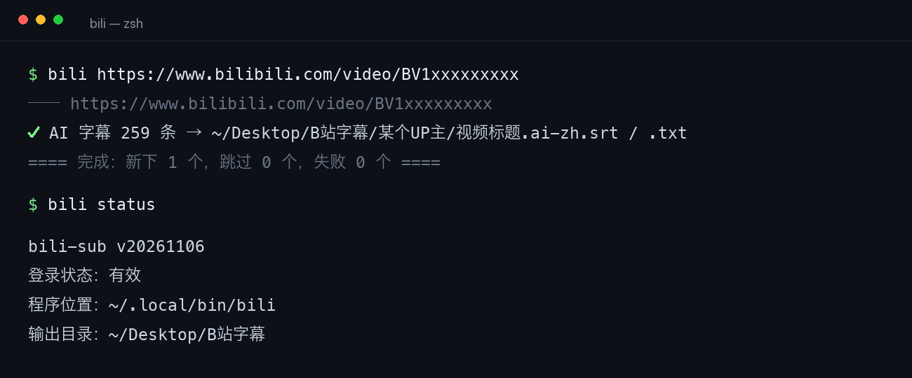

<p align="center">
  
</p>

<p align="center">
  
  
  
</p>

把 B 站视频的字幕下载到本地。一个视频给两个文件：`.srt` 丢给播放器和剪辑软件，`.txt` 给人读、给 AI 读。

零依赖，一个文件，装完就能用。只支持 macOS 和 Linux。

## 它替你做的几件事

- **按 UP 主自动分文件夹。** 下完不用自己整理，视频字幕直接躺在对应 UP 主的目录里。
- **批量。** 一个链接、十个链接、一个 `.txt` 清单、清单和链接混着写，都是一条命令。
- **下过的自动跳过。** 同一个视频再跑一次直接跳过，不重复请求；真要重下加 `--force`。
- **两个文件一起给。** `.srt` 带时间轴；`.txt` 开头就是 UP 主、链接、发布时间、时长、字幕类型，正文按停顿分好了段——喂给 AI 不用再手动清时间轴。
- **字幕只要一版，但要最合适的那版。** 中文原字幕 > 中文 AI 字幕 > 其他语言原字幕 > 其他语言 AI 字幕。
- **下不全就不写文件。** 一条字幕都没有、或者只到视频一半，直接报错，不给你一个"看起来成功"的残片。
- **一条 `status` 说清所有事。** 登录状态、版本号、装在哪、存哪、卸载要删哪几个文件，都在这。
- **不添乱。** 不建缓存、不留日志、不写索引，只写字幕文件本身。

## 用起来是什么样

```bash
bili https://www.bilibili.com/video/BV1xxxxxxxxx    # 下一条
bili BV1xxxxxxxxx BV1yyyyyyyyy                     # 下几条
bili 清单.txt                                       # 下一个清单
bili 清单.txt BV1yyyyyyyyy                          # 混着来
```

跑起来是这样：

<p align="center">
  
</p>

下完的目录长这样：

```
~/Desktop/B站字幕/                 ← 默认总目录，可以改
└── 某个UP主/                     ← 不用你建，按视频所属的 UP 主自动分
    ├── 视频标题.ai-zh.srt         ← 播放器、剪辑软件直接用
    └── 视频标题.ai-zh.txt         ← 读起来顺，也能直接喂 AI
```

`.txt` 开头是这样：

```markdown
# 视频标题

- UP 主：某个UP主
- 链接：https://www.bilibili.com/video/BV1xxxxxxxxx
- 发布时间：2026-11-06 09:30
- 视频时长：07:49
- 字幕类型：AI 字幕（ai-zh），共 259 条
- 导出时间：2026-11-06 18:22
- 工具：bili-sub v20261106

## 字幕正文

（按停顿合并成段落的正文）
```

## 所有命令

| 命令 | 干什么 |
|---|---|
| `bili <链接>` | 下一个视频，链接、BV号、av号都行 |
| `bili <清单.txt>` | 清单里每行一个链接，`#` 开头是注释 |
| `bili -p <N> <链接>` | 只下第 N 个分P，不写就下全部 |
| `bili -o <目录> <链接>` | 这次换个地方存，不改永久设置 |
| `bili --force <链接>` | 已下过的也重新下 |
| `bili --delay <秒>` | 批量时两个视频之间等几秒，默认 0.4 |
| `bili setout "<绝对路径>"` | 永久改输出目录，要绝对路径、加双引号 |
| `bili status` | 登录状态、版本号、装在哪、存哪、怎么卸载 |
| `bili setcookie` | 设置或更新登录 cookie |
| `bili help` | 显示全部命令 |

## 安装和卸载

电脑上要有 `python3`（macOS 自带，主流 Linux 也自带），不需要装别的东西。

**方式一：一行命令（最省事，没有系统拦截）**

```bash
curl -fsSL https://raw.githubusercontent.com/Zhiyi1207/bili-sub/main/install.sh | bash
```

**方式二：双击安装**

| 你的系统 | 下载这个 | 怎么用 |
|---|---|---|
| macOS | `install.command` | 先 `chmod +x` 给执行权限，再双击；第一次会被系统拦，按下节步骤放行 |
| Linux | `install.sh` | 双击，选“运行”；没这个选项就右键 → 属性 → 勾“允许作为程序执行” |

macOS 上有两道关，都是系统行为，不是脚本的问题：

**第一道：文件没有执行权限**（浏览器下载的脚本默认是只读的）。提示“无法执行，因为你没有正确的访问权限”时，跑一句：

```bash
chmod +x ~/Downloads/install.command
```

**第二道：Apple 无法验证开发者。** 照这个走：

1. 点 **“完成”**（别点“移到废纸篓”）；
2. 打开 **系统设置 → 隐私与安全性**，往下滚到“安全性”那一块；
3. 点 **“仍要打开”**，再双击一次，弹窗里点“打开”。

不想走这个流程，也可以在终端里跑一句去掉系统标记，然后双击就正常了：

```bash
xattr -d com.apple.quarantine ~/Downloads/install.command
```

**方式三：只要程序本身**

```bash
chmod +x bili && mkdir -p ~/.local/bin && mv bili ~/.local/bin/
```

安装脚本会做三件事：把 `bili` 放到 `~/.local/bin/`；如果这个目录不在 `PATH` 里，自动往 `~/.zshrc` 或 `~/.bashrc` 追加一行，改之前先备份；最后自己跑一遍确认能用。它不会碰 `/usr/local/bin`，不会碰 Homebrew 的目录，也不需要 `sudo`。

**装完想删掉**，跑 `bili status`，最后会打印你机器上真实的路径，照抄那几行就行：

```bash
rm -r "$HOME/.config/bili-sub"     # cookie 和输出目录设置
rm "$HOME/.local/bin/bili"         # 程序本体，就一个文件
```

下好的字幕在输出目录里，那是你自己的东西，删不删随意。

## 常见问题

**它说“没取到字幕”？**
先看是不是没登录。没登录时不少视频看不到字幕，跑 `bili setcookie` 粘一次 cookie 再试。设了还不行，可能这个视频确实没有字幕。

**cookie 多久要换一次？**
一般几个月。`bili status` 会告诉你还有没有效，失效了就重新粘一次，两分钟的事。

**报“接口返回 -352”？**
B 站的风控挡住了。先确认登录状态，隔一会儿再试；一直这样说明 B 站改了接口，等版本更新。

**一次下几百个会不会被挡？**
默认每个视频之间会停 0.4 秒。数量太大建议分几批，被挡了就隔十几分钟再来。

**能下视频、音频、弹幕吗？**
不能，这个工具只做字幕。

**为什么每个视频只有一版字幕？**
同一视频可能有中文原字幕、中文 AI 字幕、英文 AI 字幕等多个版本。这里只取最合适的一个（中文优先、原字幕优先），需要别的语言自己翻译。

## 小提示

**引号**：中文文件名不用引号，`bili 我的清单.txt` 直接跑。但如果路径里有空格，或者链接里带 `?`、`&`、`#`，就必须加引号，推荐一律用单引号：

```bash
bili 'https://www.bilibili.com/video/BV1xxx?p=2&t=0'
```

不加的话，`&` 会把命令截成两半，程序只收到半截链接。

**重复下载**：判断依据是 `.txt` 里记的链接。同一个视频会跳过；同名但属于别的视频的，不会覆盖，会另存成带 BV 号的名字。

**退出码**：`0` 全部成功（包括跳过），`1` 至少一个失败，`2` 用法错误。

## 不足与后续

现在明确的不足：

- 只支持 macOS 和 Linux，Windows 没做适配；
- 只下字幕，不下载视频、音频、弹幕、封面；
- 不提供语言选择，每个视频固定取一版；
- 批量只有固定间隔，没有并发，几百个建议分几批跑；
- 依赖 B 站给网页播放器用的接口，B 站改了就可能失效；
- 只有离线逻辑测试，没有联网的自动化测试。

后续会做的：B 站接口有变动就跟着修，保证它一直能用；有人报的问题会看、会修；新功能按需加，不堆。

改代码的话，`tests/offline_test.py` 可以不联网跑一遍逻辑回归。

## 许可与免责

[MIT](LICENSE)：个人、商业都能免费用，也能改、能再发布。唯一要求是保留版权声明和许可声明。

仅供个人学习、备份自己需要的字幕使用。请遵守 B 站用户协议，不要用于大规模抓取或再分发。
